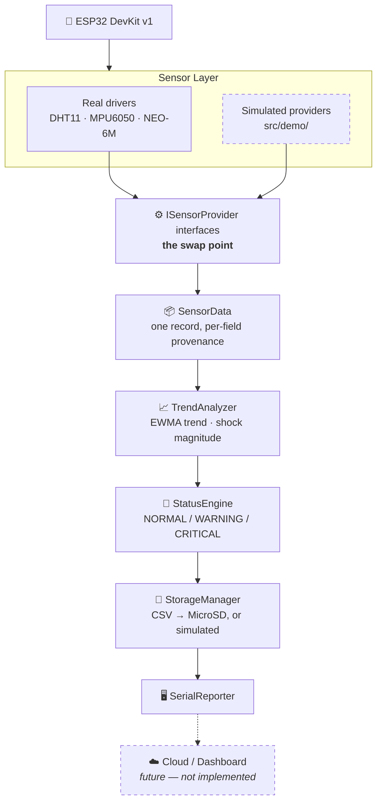

# 🧊 AI-Powered Smart Cold-Chain Monitoring System

[](https://www.espressif.com/)
[](https://www.arduino.cc/)
[](https://platformio.org/)
[](https://isocpp.org/)
[](LICENSE)
[](#-limitations)
[](docs/demo-mode.md)

An ESP32-based prototype that monitors the environmental and transport conditions
a cold-chain shipment experiences — temperature, humidity, shock, orientation and
GPS position — classifies the cargo's condition, and logs structured records to a
MicroSD card.

It runs in two modes: against **real sensors**, or in a fully **simulated demo
mode** on a bare ESP32 with nothing wired to it.

> ### ⚠️ Read this first
>
> This is a **proof-of-work prototype built for a college project**, not a
> product.
>
> - The firmware has **not** been validated against physically assembled
>   hardware. It is written against the documented pin map and the standard
>   Arduino libraries, but no claim is made that a working unit was built.
> - The alarm thresholds are **demonstration values**. They are not medically or
>   industrially certified and are not derived from any pharmaceutical,
>   food-safety, WHO or industrial cold-chain specification.
> - **Do not use this to monitor real perishable or medical cargo.**
> - Output produced in demo mode is **simulated**, and is never evidence that a
>   sensor works. See [Demo Mode](#-demo-mode).

---

## 📋 Table of Contents

| | | |
|---|---|---|
| [Overview](#-overview) | [Architecture](#-system-architecture) | [Installation](#-installation) |
| [Problem Statement](#-problem-statement) | [Hardware](#-hardware-components) | [Build & Upload](#-build-and-upload) |
| [Proposed Solution](#-proposed-solution) | [Pin Configuration](#-pin-configuration) | [Serial Monitor](#-serial-monitor) |
| [Objectives](#-objectives) | [Software Stack](#-software-stack) | [Example Output](#-example-output) |
| [Sensors](#-sensor-descriptions) | [Project Structure](#-project-structure) | [Future Enhancements](#-future-enhancements) |
| [Demo Mode](#-demo-mode) | [Data Flow](#-data-flow) | [Limitations](#-limitations) |
| [Real Hardware Mode](#-real-hardware-mode) | [CSV Format](#-csv-data-format) | [Disclaimer](#-disclaimer) |
| [Status Logic](#-cold-chain-status-logic) | [What the AI is](#what-the-ai-actually-is) | [License](#-license) |

---

## 🎯 Overview

A cold chain is the unbroken sequence of refrigerated storage and transport that
keeps perishable goods — vaccines, blood products, dairy, produce, seafood — within
a safe temperature range from producer to consumer. When that chain breaks, the
damage is usually **invisible**: a vaccine that spent four hours at 20 °C looks
exactly like one that never left 5 °C.

This project builds an ESP32 device that watches the conditions continuously, so a
break leaves a record instead of going unnoticed.

It monitors:

| Dimension | Sensor | Why it matters |
|---|---|---|
| 🌡️ Temperature | DHT11 | The primary spoilage driver |
| 💧 Humidity | DHT11 | Packaging integrity, condensation, mould |
| 📉 Acceleration | MPU6050 | Drops and impacts — damage temperature cannot show |
| 🔄 Orientation | MPU6050 | Cargo tipped or rolled |
| 📍 Location | NEO-6M | *Where* on the route a problem occurred |
| 💾 Storage | MicroSD | A durable record with no network needed |
| 🚦 Overall status | Firmware | A single verdict: NORMAL / WARNING / CRITICAL |

---

## ❗ Problem Statement

Roughly a quarter of vaccines reach their destination degraded, and cold-chain
failures account for a large share of global food loss. The recurring reasons are
structural:

1. **Failures are invisible.** Spoiled cargo usually looks fine. Without a
   record, nobody knows a limit was ever crossed.
2. **Monitoring is discrete, not continuous.** A thermometer read at loading and
   unloading says nothing about the eight hours between — which is when failures
   happen.
3. **Temperature alone is an incomplete picture.** Cargo can arrive at exactly
   the right temperature and still be ruined by being dropped.
4. **Excursions are not located.** Knowing a shipment got warm is far less
   actionable than knowing *which leg, which depot, which vehicle*.
5. **Alerts arrive too late.** A system that reports a breach only once the limit
   is crossed reports a loss, not a risk. By then intervention is impossible.
6. **Commercial loggers are closed and costly**, which puts continuous monitoring
   out of reach for small operators.

---

## 💡 Proposed Solution

A low-cost ESP32 device that travels with the shipment and addresses each point
above:

| Problem | How this prototype addresses it |
|---|---|
| Invisible failures | Every sample is logged to a CSV on a MicroSD card |
| Discrete checks | Continuous sampling every 2 seconds |
| Temperature only | Adds shock, orientation and humidity |
| Unlocated excursions | GPS coordinates on every record |
| Alerts too late | A **predictive** trend rule warns while readings are still in band |
| Closed and costly | Open source, ~₹1,200 / ~US$15 in parts |

The design principle throughout is that **the firmware never reports more than it
can substantiate.** Every record carries per-field provenance saying whether each
number was measured, simulated, or re-served after a failed read — so a demo
transcript can never be mistaken for evidence the hardware works.

---

## ✅ Objectives

1. Continuously acquire temperature, humidity, 3-axis acceleration, 3-axis
   rotation and GPS position on one embedded platform.
2. Normalise every reading into a **single record type** that the rest of the
   system consumes, so sources are interchangeable.
3. Classify each sample into `NORMAL` / `WARNING` / `CRITICAL` using configurable
   thresholds, with **debouncing** so one noisy sample cannot raise an alarm.
4. Detect transport **shock and tilt** events that temperature monitoring misses.
5. Provide an **early warning** from the rate of change, before a limit is
   crossed.
6. Persist all records as CSV, consumable by a future dashboard or backend.
7. Present a clear live serial view that **labels every value's origin**.
8. Support a complete **simulation mode** so the software can be developed,
   demonstrated and reviewed without hardware.
9. Keep the layers separated well enough that adding a cloud uplink touches no
   existing sensor, status or storage code.

---

## 🏗️ System Architecture



**The one idea that shapes everything:** the application must not know whether a
number came from a sensor or a simulator. `main.cpp` holds three *interface*
pointers; which concrete object sits behind them is decided once, at compile
time, in a single `#if DEMO_MODE` block. The analytics, status, storage and
reporting layers contain **no** `#if DEMO_MODE` at all.

Full detail, including the trade-offs behind each decision:
**[docs/architecture.md](docs/architecture.md)**

---

## 🔧 Hardware Components

| # | Component | Interface | Supply | Role |
|---|---|---|---|---|
| 1 | **ESP32 DevKit v1** | — | 5 V USB | Controller, all processing |
| 2 | **DHT11** | 1-Wire | 3.3 V | Temperature + humidity |
| 3 | **MPU6050** | I²C | 3.3 V | Accelerometer + gyroscope |
| 4 | **NEO-6M** | UART 9600 | 3.3 V | GPS position |
| 5 | **MicroSD module** | SPI | 3.3 V | CSV logging |

> LEDs and buzzers are **not** part of this revision. No indicator GPIO is
> allocated or driven.

Per-component detail, configuration rationale and upgrade paths:
**[docs/hardware.md](docs/hardware.md)**

---

## 📌 Pin Configuration

| Module | Module pin | ESP32 | GPIO | Bus |
|---|---|---|---|---|
| **DHT11** | OUT | D4 | 4 | 1-Wire |
| | + | 3V3 | — | Power |
| | − | GND | — | Ground |
| **MPU6050** | SDA | D21 | 21 | I²C data |
| | SCL | D22 | 22 | I²C clock |
| | VCC | 3V3 | — | Power |
| | GND | GND | — | Ground |
| **NEO-6M** | TX | D16 | 16 | UART2 RX ← |
| | RX | D17 | 17 | UART2 TX → |
| | VCC | 3V3 | — | Power |
| | GND | GND | — | Ground |
| **MicroSD** | MOSI | D23 | 23 | SPI MOSI |
| | MISO | D19 | 19 | SPI MISO |
| | SCK | D18 | 18 | SPI clock |
| | CS | D13 | 13 | SPI chip select |
| | VCC | 3V3 | — | Power |
| | GND | GND | — | Ground |

> ### ⚠️ The GPS wires cross over
>
> `PIN_GPS_RX` (D16) is where the **ESP32 receives**, so it connects to the GPS
> module's **TX**. This is the most common wiring mistake and it fails silently —
> the module powers up and its LED may blink while not one byte arrives.
>
> ```
> NEO-6M TX ──────► D16   (ESP32 RX2)
> NEO-6M RX ◄────── D17   (ESP32 TX2)
> ```

All pins are defined in one place, [`src/config.h`](src/config.h). Wiring
diagram, GPIO pins to avoid, and bus notes:
**[docs/pinout.md](docs/pinout.md)**

---

## 💻 Software Stack

| Layer | Choice |
|---|---|
| Language | C++11 (Arduino dialect) |
| Framework | Arduino for ESP32 |
| Build system | PlatformIO |
| Target | `espressif32` / `esp32dev` |
| Serial | 115200 baud |

### Required libraries

All are resolved automatically by PlatformIO from
[`platformio.ini`](platformio.ini) — no manual installation needed.

| Library | Version | Used for |
|---|---|---|
| [`adafruit/DHT sensor library`](https://github.com/adafruit/DHT-sensor-library) | ^1.4.6 | DHT11 |
| [`adafruit/Adafruit Unified Sensor`](https://github.com/adafruit/Adafruit_Sensor) | ^1.1.14 | Sensor abstraction, SI units |
| [`adafruit/Adafruit MPU6050`](https://github.com/adafruit/Adafruit_MPU6050) | ^2.2.6 | MPU6050 |
| [`mikalhart/TinyGPSPlus`](https://github.com/mikalhart/TinyGPSPlus) | ^1.1.0 | NMEA parsing |
| `Wire`, `SPI`, `SD`, `HardwareSerial` | bundled | I²C, SPI, card, UART |

---

## 📁 Project Structure

```
ai-smart-cold-chain-monitoring/
├── README.md
├── LICENSE                        MIT
├── .gitignore
├── platformio.ini                 two envs: demo + real
│
├── docs/
│   ├── architecture.md            layers, data flow, design trade-offs
│   ├── hardware.md                every component, limits, upgrades
│   ├── pinout.md                  complete pin table + wiring
│   ├── data-format.md             every CSV field explained
│   └── demo-mode.md               exactly what is simulated, and how
│
├── include/
│   └── README.md
│
└── src/
    ├── main.cpp                   the 5-step cycle; the ONLY #if DEMO_MODE
    ├── config.h                   pins, timing, thresholds — single source
    │
    ├── models/
    │   └── SensorData.h           the one record type + provenance enums
    │
    ├── sensors/
    │   ├── ISensorProvider.h      ⭐ the interface seam
    │   ├── DHT11Sensor.{h,cpp}    real temperature + humidity
    │   ├── MPU6050Sensor.{h,cpp}  real accelerometer + gyroscope
    │   └── GPSSensor.{h,cpp}      real NMEA over UART2
    │
    ├── demo/
    │   └── DemoSensorData.{h,cpp} simulated providers, same interfaces
    │
    ├── analytics/
    │   └── TrendAnalyzer.{h,cpp}  EWMA trend, shock magnitude
    │
    ├── status/
    │   └── StatusEngine.{h,cpp}   threshold rules + debouncing
    │
    ├── storage/
    │   └── StorageManager.{h,cpp} CSV to card, or simulated
    │
    └── reporting/
        └── SerialReporter.{h,cpp} the live dashboard
```

This extends the layout in the project brief with three additions:
`sensors/ISensorProvider.h` (the interface seam that makes the swap possible),
`analytics/` (separating derived signals from classification), and `reporting/`
(keeping all text formatting in one place).

---

## 🔬 Sensor Descriptions

### 🌡️ DHT11 — Temperature and Humidity

Capacitive humidity sensor plus thermistor, 1-Wire digital output.
**0–50 °C ±2 °C, 20–90 % RH ±5 %**, max ~1 Hz.

**Its limits, stated plainly.** The DHT11 resolves **1 °C** and is accurate to
**±2 °C** — its error bar is wider than the 2–8 °C pharmaceutical band it would
need to verify. It also cannot read below 0 °C, so frozen cargo is out of reach.
It is here because it is the standard, cheapest first-prototype part; for serious
work, use an **SHT31** (±0.2 °C) or **DS18B20**.

It returns `NaN` fairly often, so the driver re-serves the last good value tagged
`STALE` rather than publishing garbage, and gives up after 3 consecutive failures.

### 📉 MPU6050 — Accelerometer and Gyroscope

6-axis IMU over I²C, 16-bit, configured here at **±8 g** and **±500 °/s** with a
**21 Hz** low-pass filter. (±8 g because a drop easily exceeds 4 g and clipping
the impact would defeat the purpose; 21 Hz because road and motor vibration above
that would only alias into a 0.5 Hz sample loop.)

**At rest it reads ~9.81 m/s² on Z, not zero** — an accelerometer measures the
normal force holding it up. So the useful quantity is the departure from gravity
in either direction: `shock = | |a| − 9.81 |`. A jolt pushes it above; free fall
pushes it toward zero.

### 📍 NEO-6M — GPS

u-blox 50-channel receiver, NMEA over UART at 9600 baud, ~2.5 m accuracy.

**It will not get a fix indoors**, and a cold start takes 30 s to several
minutes. So `begin()` deliberately does not wait for a fix — it confirms only
that bytes are arriving. A fix older than 30 s is re-served tagged `STALE`: a
vehicle entering a tunnel should not silently appear parked at the tunnel mouth.

### 💾 MicroSD — Storage

SPI at a deliberately conservative 4 MHz (breadboard jumpers carry enough stray
capacitance to make faster clocks unreliable). Card must be **FAT32**.

Each row opens, appends and closes the file. That is slower than holding the
handle open, but it means a completed row survives an unexpected power cut —
which for a logger is the property that matters.

---

## 🔄 Data Flow

```mermaid
sequenceDiagram
    participant L as loop()
    participant P as Providers
    participant A as TrendAnalyzer
    participant S as StatusEngine
    participant D as StorageManager
    participant R as SerialReporter

    L->>P: service()
    Note over L,P: every pass — drains the GPS UART

    L->>L: 2000 ms elapsed?
    L->>P: read(sample) ×3
    Note over P: each fills only its own fields<br/>and tags its own provenance

    L->>A: update(sample)
    Note over A: shock magnitude + EWMA trend

    L->>S: evaluate(sample)
    Note over S: thresholds + debounce → verdict

    L->>D: append(sample)
    Note over D: CSV row; sets storageStatus

    L->>R: printRecord(sample)
    Note over R: prints THIS cycle's true outcome
```

The order is deliberate: analytics must run **before** the status engine (which
consumes what it derives), and storage **before** reporting (so the printed
record shows this row's true storage outcome, not the previous one's).

---

## 📊 CSV Data Format

```csv
timestamp,temperature,humidity,accel_x,accel_y,accel_z,gyro_x,gyro_y,gyro_z,latitude,longitude,altitude,satellites,system_status,demo_mode
```

Real rows from a demo run:

```csv
50,30.7,56.7,0.105,0.098,9.795,0.019,-0.003,-0.012,12.971221,80.043305,17.2,6,NORMAL,1
2050,30.6,57.0,-0.066,0.098,9.850,0.027,-0.024,-0.011,12.971239,80.043316,19.0,6,NORMAL,1
286050,34.6,48.0,0.014,0.157,9.762,-0.013,-0.003,0.018,12.973453,80.042931,18.4,6,CRITICAL,1
```

| Column | Unit | Notes |
|---|---|---|
| `timestamp` | ms | **Uptime, not wall-clock** — no RTC. Wraps at ~49.7 days |
| `temperature` | °C | 1 dp — all a DHT11 resolves |
| `humidity` | % RH | 1 dp |
| `accel_x/y/z` | m/s² | Z ≈ **+9.81 at rest**, not 0 |
| `gyro_x/y/z` | rad/s | ×57.3 for °/s |
| `latitude`, `longitude` | ° | WGS-84, 6 dp. **`0,0` means no fix** |
| `altitude` | m | GPS altitude is ±10 m or worse — indicative only |
| `satellites` | count | ≥4 needed for a 3D fix |
| `system_status` | keyword | `NORMAL` / `WARNING` / `CRITICAL` / `UNKNOWN` |
| `demo_mode` | 0/1 | **`1` = synthetic. Not evidence of anything physical** |

Every field explained, known format limitations, and a pandas reader:
**[docs/data-format.md](docs/data-format.md)**

---

## 🚦 Cold-Chain Status Logic

> ### ⚠️ Prototype thresholds
> The values below were chosen so a desk demo produces a readable mix of states.
> They are **not medically or industrially certified** and are not derived from
> any cold-chain standard. A real deployment replaces them with the limits its
> specific commodity requires.

All thresholds live in [`src/config.h`](src/config.h).

### Temperature bands

```
 CRITICAL │ WARNING │        NORMAL        │ WARNING │ CRITICAL
──────────┼─────────┼──────────────────────┼─────────┼──────────
         4.0       8.0                   33.0     34.5   °C
```

**Why the upper bound is 33 °C and not 8 °C.** A genuine vaccine chain is 2–8 °C.
This prototype is demonstrated at ambient Chennai temperature, and the simulator
walks 28–35 °C. A real 2–8 °C band applied to that input would report `CRITICAL`
on every sample — demonstrating nothing, because an engine that never changes
state cannot be seen to work. The lower bounds are kept at plausible
chilled-cargo values and are unreachable in demo mode, so the two-sided logic is
still visible. **Swapping these four numbers is the entire change** needed to
point this at real chilled cargo.

### The rules, in priority order

| # | Condition | Verdict |
|---|---|---|
| 1 | No usable environment data | `UNKNOWN` |
| 2 | Temperature outside a critical bound | `CRITICAL` |
| 3 | Shock ≥ 8.0 m/s² excess | `CRITICAL` — impact |
| 4 | Humidity ≥ 85 % | `CRITICAL` |
| 5 | Temperature outside a warning bound | `WARNING` |
| 6 | Humidity outside a warning bound | `WARNING` |
| 7 | Shock ≥ 3.0 m/s² excess | `WARNING` — rough handling |
| 8 | Rotation ≥ 1.5 rad/s | `WARNING` — tipping |
| 9 | \|trend\| ≥ 2.5 °C/min | `WARNING` — **predicted** excursion |
| 10 | otherwise | `NORMAL` |

The highest-severity matching rule wins, and its reason string is reported — so
an operator sees *why*, not just a colour.

### Debouncing, and the exception that matters

A sustained condition must persist for **2 consecutive samples** before it
escalates, so one noisy DHT11 reading cannot raise an alarm. De-escalation is
immediate.

**Impacts, shocks and sharp rotations are exempt** — and must be. A drop is over
in milliseconds and appears in exactly one sample, so requiring two consecutive
samples would mean impacts were **never reported at all**. A single `CRITICAL`
row surrounded by `NORMAL` is therefore correct behaviour, not a glitch.

### What the "AI" actually is

Honesty matters more than the buzzword, so:

> **There is no neural network, no trained model, and no inference engine on this
> ESP32.** The analytics are an exponentially-weighted moving average and
> arithmetic. Please do not describe this as machine learning.

What it *does* do is worth having. Rule 9 tracks the smoothed **rate of change**
of temperature, so the system can say *"still in band, but warming fast enough to
leave it shortly"* — the difference between an alarm (a loss already happened) and
a warning that is still actionable. That forward-looking judgement is the only
sense in which the title's "AI-powered" is meant.

Two implementation notes:

- **EWMA over a sliding window**, because it needs one float of state instead of
  an N-sample ring buffer, has no window-boundary artefacts, and responds
  smoothly.
- **The rate gets its own, much slower smoothing coefficient** than the value
  does. Differentiating amplifies noise: at a 2-second interval a single 0.25 °C
  wobble is an instantaneous 7.5 °C/min, so a lightly smoothed rate would sit
  above any useful threshold permanently and the predictive rule would fire
  constantly on noise.

---

## 🎬 Demo Mode

`DEMO_MODE` runs the **complete pipeline** on a bare ESP32 with nothing wired to
it.

> **Simulated output is not evidence that any sensor works.** In demo mode the
> firmware does not read, probe or touch the DHT11, MPU6050, NEO-6M or SD card.

The firmware is built so this cannot be blurred by accident — every value is
tagged, and every serial block prints its own provenance:

```
ENVIRONMENT   [DEMO/SIMULATED]
STORAGE
  Status  : SIMULATED          ← never "LOGGING" in demo mode
```

### What is and is not simulated

| Subsystem | In demo mode |
|---|---|
| Temperature / humidity | Simulated (or real, with `DEMO_TRY_REAL_DHT=1`) |
| Accelerometer / gyroscope | Simulated |
| GPS | Simulated |
| MicroSD | **Not touched** — row formatted, counter advanced, nothing written |
| Analytics, status engine, reporter | **Real code**, running on simulated input |

The analytics and status engine are *never* simulated — they are the same objects
the real build uses, running the same rules. Only their input differs.

### Not a random-number generator

```cpp
temperature = random(28, 35);   // ❌ 28.4 → 34.9 → 29.1 → 33.8
```

No physical quantity jumps across its whole range every sample. Instead:

- **Temperature** = a slow **7-minute thermal cycle** (28–35 °C) plus small
  carried-over noise. The cycle is the signal — it gives the demo a real arc:
  warm up, cross the warning bound, peak near critical, recover. The period is set
  from the *ramp rate* it implies (~3.1 °C/min, plausible for a small insulated
  box losing cooling) rather than from impatience.
- **Humidity** is **derived from temperature** at −2.2 %RH/°C, because warm air
  holds more moisture before saturating. The humidity trace therefore corroborates
  the temperature story rather than contradicting it.
- **Motion** = gravity on Z plus a realistic noise floor, with **two tiers** of
  injected bump: common rough handling (3.5–6 m/s²) and rare impacts (9–14 m/s²),
  each adding a matching rotation the way a real jolt does.
- **GPS** walks along a slowly turning **heading** (not independent lat/lon
  jitter, which gives a cloud of unrelated points), with longitude scaled by
  `1/cos(latitude)` so the track does not appear to move faster east–west. It is
  leashed to ~250 m of the origin.
- **Randomness is seeded per boot** from the hardware RNG, and the cycle starts at
  a random phase — two runs do not replay an identical trace.

Real consecutive output:

```
30.7 → 30.6 → 30.4 → 30.3 → 30.0 → 29.8 → 29.6 → 29.5 °C
56.7 → 57.0 → 57.7 → 58.1 → 59.6 → 60.4 → 60.9 → 60.9 %   (rising as temp falls)
```

Simulated origin: **12.9716, 80.0434** — Chennai Institute of Technology,
Kundrathur, Chennai.

> ⏱️ **One full thermal arc takes 7 minutes.** A 30-second glance will usually
> show a steady `NORMAL` — that is the system working, not the demo being broken.
> Let it run a few minutes to see the transitions.

Measured over 400 samples (~13 min): **~53 % NORMAL, ~36 % WARNING, ~11 %
CRITICAL**, with every rule in the engine firing at least once.

Complete detail on every simulated range and why each was chosen:
**[docs/demo-mode.md](docs/demo-mode.md)**

---

## 🔌 Real Hardware Mode

Build with `DEMO_MODE=0` and the real drivers take over, on the pins in
[docs/pinout.md](docs/pinout.md).

```bash
pio run -e esp32dev-real -t upload
```

### What to expect

1. **The boot banner reports each subsystem individually** as `OK` or `FAILED`.
2. **A failed subsystem does not stop the system.** Its fields are reported
   `UNAVAILABLE` rather than filled with fabricated data:
   ```
   ENVIRONMENT   [UNAVAILABLE]
     Temperature : --   (sensor not responding)
   ```
3. **No GPS fix indoors.** The banner says `OK (streaming; fix may take
   minutes)` — "OK" means the module is talking, not that it knows where it is.
4. **The card must be FAT32.** exFAT is unsupported, and >32 GB cards often ship
   exFAT-formatted.
5. **Replace the thresholds** in `config.h` with what your cargo actually
   requires.

### The middle option

`DEMO_TRY_REAL_DHT=1` with `DEMO_MODE=1` reads the **real DHT11** while simulating
motion and GPS — useful because the DHT11 is the cheapest sensor to wire, so you
can validate the real acquisition path with one component attached. Records stay
honest field by field:

```
ENVIRONMENT   [REAL SENSOR]        ← actually measured
MOTION        [DEMO/SIMULATED]     ← synthesised
LOCATION      [DEMO/SIMULATED]     ← synthesised
```

This is exactly why `SensorData` carries per-field provenance instead of one
global flag.

---

## 📥 Installation

### Prerequisites

- [PlatformIO Core](https://docs.platformio.org/en/latest/core/installation/) or
  the [PlatformIO IDE extension](https://platformio.org/install/ide?install=vscode)
  for VS Code
- A USB cable and an ESP32 DevKit
- On some systems, the [CP210x](https://www.silabs.com/developers/usb-to-uart-bridge-vcp-drivers)
  or CH340 USB-serial driver

### Clone and build

```bash
git clone https://github.com/MuthuTej/ai-smart-cold-chain-monitoring.git
cd ai-smart-cold-chain-monitoring

# Libraries are resolved automatically from platformio.ini
pio run -e esp32dev-demo
```

### PlatformIO setup

[`platformio.ini`](platformio.ini) defines two environments so switching modes
never means editing source:

```ini
[env:esp32dev-demo]     ; DEMO_MODE=1 — no hardware needed  (default)
[env:esp32dev-real]     ; DEMO_MODE=0 — real drivers
```

Shared settings: `espressif32` / `esp32dev` / `arduino`, 115200 monitor baud, and
the four library dependencies.

---

## 🚀 Build and Upload

```bash
# Demo mode — safe on a bare ESP32 with nothing attached
pio run -e esp32dev-demo -t upload

# Real hardware mode
pio run -e esp32dev-real -t upload

# Upload and immediately open the monitor
pio run -e esp32dev-demo -t upload -t monitor

# Build only, no upload
pio run -e esp32dev-demo

# Clean
pio run -t clean
```

If the upload fails to start, hold the **BOOT** button while it connects. Specify
the port explicitly if auto-detection picks the wrong one:

```bash
pio run -e esp32dev-demo -t upload --upload-port /dev/ttyUSB0   # macOS: /dev/cu.usbserial-*
```

---

## 🖥️ Serial Monitor

**115200 baud.**

```bash
pio device monitor -b 115200

# or with the exception decoder, which turns a crash dump into line numbers
pio device monitor -b 115200 --filter esp32_exception_decoder
```

The Arduino IDE Serial Monitor and `screen /dev/ttyUSB0 115200` work equally
well.

**Reading the output:** every block carries a provenance tag in brackets. That tag
is the authoritative statement of where the numbers came from:

| Tag | Meaning |
|---|---|
| `[REAL SENSOR]` | A physical read succeeded this cycle |
| `[DEMO/SIMULATED]` | Synthesised by `src/demo/` |
| `[STALE (last known)]` | Last good value re-served after a failed read |
| `[UNAVAILABLE]` | No value — sensor absent or not responding |

In demo mode each CSV row is also echoed prefixed `[csv]`, so the storage format
is visible without a card.

---

## 📺 Example Output

Captured from an actual demo run.

### Boot

```
==================================================
  AI SMART COLD-CHAIN MONITORING
==================================================
Firmware : AI Smart Cold-Chain Monitoring v0.1.0-prototype
Device   : CCM-ESP32-01
MODE     : DEMO / SIMULATION
Interval : 2000 ms

SUBSYSTEM INITIALISATION
  Environment : DHT11 (DEMO/SIMULATED)  -> OK
  Motion      : MPU6050 (DEMO/SIMULATED)  -> OK
  Location    : NEO-6M GPS (DEMO/SIMULATED)  -> OK (streaming; fix may take minutes)
  Storage     : MicroSD (DEMO/SIMULATED)  -> no card accessed

NOTE: Prototype thresholds only. The temperature and
      humidity limits used by the status engine were
      chosen for demonstration and are NOT medically or
      industrially certified. Do not use this device to
      monitor real perishable or medical cargo.
==================================================
```

### A normal sample

```
==================================================
  AI SMART COLD-CHAIN MONITORING
==================================================
MODE     : DEMO
SAMPLE   : #37   UPTIME: 00:01:12

ENVIRONMENT   [DEMO/SIMULATED]
  Temperature : 28.0 C
  Humidity    : 62.8 %
  Trend       : -1.66 C/min  (EWMA smoothed)

MOTION   [DEMO/SIMULATED]
  Acceleration X : 0.16 m/s2
  Acceleration Y : 0.09 m/s2
  Acceleration Z : 9.74 m/s2

  Gyroscope X : 0.00 rad/s
  Gyroscope Y : 0.02 rad/s
  Gyroscope Z : 0.01 rad/s

  Shock       : 0.07 m/s2 excess
  Peak shock  : 5.31 m/s2   Events: 2

LOCATION   [DEMO/SIMULATED]
  Latitude   : 12.971866
  Longitude  : 80.043175
  Altitude   : 17.8 m
  Speed      : 0.1 km/h
  Satellites : 8
  Fix        : VALID

STORAGE
  Status  : SIMULATED
  Records : 37

SYSTEM STATUS
  NORMAL
  Reason: all monitored parameters within prototype limits
==================================================
```

### A critical sample, with a shock event

Note the `<-- SHOCK EVENT` marker, the 11.23 m/s² spike on X with a matching
2.81 rad/s rotation, and the reason string naming which rule fired:

```
MODE     : DEMO
SAMPLE   : #143   UPTIME: 00:04:44

ENVIRONMENT   [DEMO/SIMULATED]
  Temperature : 34.6 C
  Humidity    : 47.9 %
  Trend       : 2.15 C/min  (EWMA smoothed)

MOTION   [DEMO/SIMULATED]
  Acceleration X : 11.23 m/s2
  Acceleration Y : 0.15 m/s2
  Acceleration Z : 9.87 m/s2

  Gyroscope X : 0.01 rad/s
  Gyroscope Y : 2.81 rad/s
  Gyroscope Z : 0.02 rad/s

  Shock       : 5.15 m/s2 excess   <-- SHOCK EVENT
  Peak shock  : 5.80 m/s2   Events: 6

LOCATION   [DEMO/SIMULATED]
  Latitude   : 12.973449
  Longitude  : 80.042911
  Altitude   : 18.5 m
  Speed      : 4.4 km/h
  Satellites : 6
  Fix        : VALID

STORAGE
  Status  : SIMULATED
  Records : 143

SYSTEM STATUS
  CRITICAL
  Reason: temperature above critical high threshold
==================================================
```

---

## 🔮 Future Enhancements

### Closing the honesty gaps first

| # | Enhancement | Why it comes first |
|---|---|---|
| 1 | **Upgrade the temperature sensor** (SHT31 / DS18B20) | The DHT11's ±2 °C makes real cold-chain verification impossible. Nothing else matters more |
| 2 | **Add an RTC** (DS3231) or NTP | Timestamps are currently uptime, so records cannot be placed in real time |
| 3 | **Add provenance to the CSV** | The serial view discloses per-field origin; the CSV does not |
| 4 | **Validate on assembled hardware** | The drivers are unverified against a physical build |

### Then the capability work

| # | Enhancement | Notes |
|---|---|---|
| 5 | **Wi-Fi / MQTT uplink** | The ESP32 radio is already idle; `SensorData` is shaped for it |
| 6 | **Web / mobile dashboard** | Live map, temperature chart, alarm feed |
| 7 | **SMS / push alerts** | An alarm nobody sees is not an alarm |
| 8 | **Battery + deep sleep** | Required for genuine in-transit use |
| 9 | **Geofencing** | Flag arrival and departure per depot |
| 10 | **Buffer-and-forward** | Card is the buffer; sync opportunistically when connectivity returns |
| 11 | **IP-rated enclosure** | Breadboard is not transport-ready |
| 12 | **Multiple probes** | One point measurement misrepresents a large container |
| 13 | **On-device anomaly detection** | A *real* trained model (TinyML) rather than the current heuristic |
| 14 | **Tamper detection** | Light sensor or reed switch for unauthorised opening |
| 15 | **OTA updates** | Reflashing a sealed unit by USB is impractical |

---

## ⚠️ Limitations

Stated plainly, because a prototype that overstates itself is worse than one that
does less.

### Verification

- **The firmware has not been validated against physically assembled hardware.**
  It is written against the documented pin map and standard libraries. The logic
  has been exercised — the analytics, status engine, storage formatter and
  reporter were compiled and run against controlled input, which is how the
  figures and sample output in this README were produced — but that verifies
  *software*, not wiring.
- **Demo output proves nothing about sensors.** By design, `DEMO_MODE` never
  touches them.

### Measurement

- **DHT11 ±2 °C / 1 °C resolution** — cannot verify any real cold-chain band; its
  error bar is wider than a 2–8 °C window.
- **DHT11 minimum 0 °C** — frozen cargo is unmeasurable.
- **One temperature point** — a single probe misrepresents a large container.
- **GPS altitude ±10 m or worse** — indicative only.
- **No GPS fix indoors** — inherent to GPS, not fixable in software.

### Timekeeping

- **No RTC or NTP.** `timestamp` is milliseconds since boot, not wall-clock time.
- **It wraps after ~49.7 days** of continuous uptime.
- **Each reboot restarts the counter**, so one file may hold several runs with
  overlapping timestamps.

### Thresholds

- **Not certified.** Demonstration values, not derived from any standard.
- **Tuned for a desk demo**, not for cargo — the upper bounds sit inside the
  simulated ambient band so the engine can be *seen* to change state.
- **No commodity profiles.** One global set of limits, not per-cargo rules.

### The "AI"

- **No trained model on-device.** An EWMA plus arithmetic. See
  [What the AI actually is](#what-the-ai-actually-is).
- **The trend rule is heuristic** — a single tunable rate threshold, not learned
  behaviour, and it can be fooled by a noisy sensor.

### System

- **No network.** No Wi-Fi, MQTT or cloud uplink in this revision.
- **No power management.** Mains/USB powered; no deep sleep.
- **No alerting.** Status is reported to serial and CSV; nobody is notified.
- **Mode is compile-time.** Switching needs a re-flash.
- **No safe card eject**, no encryption at rest, no tamper detection.
- **CSV drops fields the firmware tracks** — provenance, fix validity, shock,
  trend, reason. See
  [data-format.md](docs/data-format.md#known-limitations-of-this-format).

---

## 📄 Disclaimer

**This is a prototype and a proof of work, created as a college project.**

- It is **not** a certified, validated, or commercially usable cold-chain
  monitoring device.
- Its thresholds are **not** medically or industrially certified, and are not
  derived from any pharmaceutical, food-safety, WHO or industrial specification.
- The firmware has **not** been validated against physically assembled hardware.
  No claim is made that a working unit was built or tested.
- **Do not use it to monitor real perishable goods, pharmaceuticals, vaccines,
  blood products, or anything where spoilage carries health or financial
  consequence.**
- Data produced in `DEMO_MODE` is **simulated** and must never be presented as
  real measurement.
- Provided **as is**, without warranty of any kind. See [LICENSE](LICENSE).

The author accepts no liability for loss or damage arising from use of this
software or its derivatives.

---

## 📜 License

Released under the [MIT License](LICENSE). © 2026 MuthuTej

---

## 📚 Documentation Index

| Document | Contents |
|---|---|
| [docs/architecture.md](docs/architecture.md) | Layers, cycle order, design trade-offs, what is deliberately absent |
| [docs/hardware.md](docs/hardware.md) | Every component, configuration rationale, limits, upgrade paths |
| [docs/pinout.md](docs/pinout.md) | Complete pin table, wiring diagram, GPIOs to avoid |
| [docs/data-format.md](docs/data-format.md) | Every CSV field, format limitations, pandas reader, JSON mapping |
| [docs/demo-mode.md](docs/demo-mode.md) | Exactly what is simulated and how each range was chosen |
