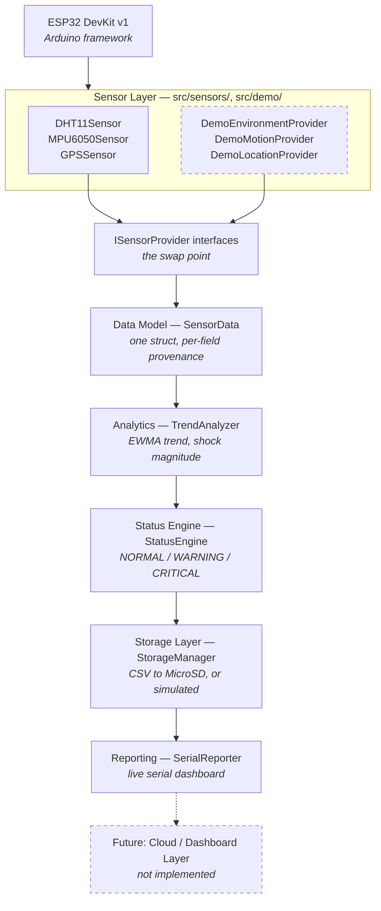
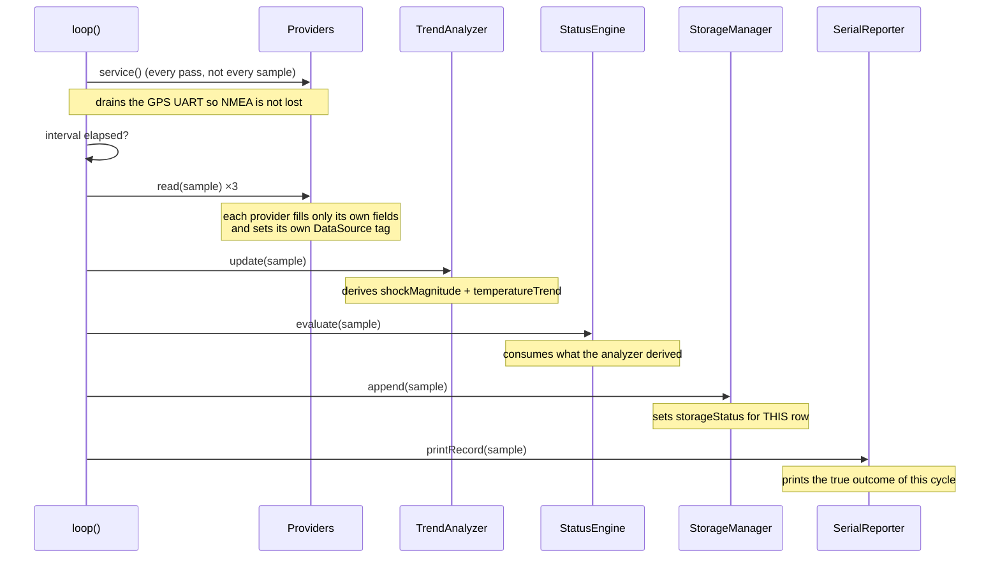

# Architecture

## The layer stack

Data flows in one direction. Each layer knows only the layer directly beneath
it, and every layer above the drivers speaks only `SensorData`.



## The one idea worth understanding

Everything in this design exists to serve a single constraint:

> **The application must not know whether a number came from a sensor or from a
> simulator.**

That is enforced by the interfaces in
[`src/sensors/ISensorProvider.h`](../src/sensors/ISensorProvider.h). `main.cpp`
holds three pointers:

```cpp
static IEnvironmentProvider* envProvider      = &envProviderImpl;
static IMotionProvider*      motionProvider   = &motionProviderImpl;
static ILocationProvider*    locationProvider = &locationProviderImpl;
```

Which concrete object sits behind each pointer is decided once, at compile time,
inside a single `#if DEMO_MODE` block. Nothing else in the firmware branches on
the mode. The analytics, status, storage and reporting layers contain **no**
`#if DEMO_MODE` at all.

The practical consequences:

| Want to… | Files you touch |
|---|---|
| Swap simulated GPS for the real NEO-6M | `platformio.ini` (one flag) |
| Add a BLE temperature tag as a new source | one new `IEnvironmentProvider` |
| Change the alarm rules | `config.h` + `StatusEngine.cpp` |
| Add a cloud uplink | one new consumer of `SensorData` |

## One cycle, in order

`loop()` in [`src/main.cpp`](../src/main.cpp) runs five steps. The order is not
arbitrary.



Why this order:

- **`service()` runs on every pass**, not once per sample. A NEO-6M streams
  continuously at 9600 baud into a 128-byte FIFO. Draining it only every 2
  seconds would overflow the buffer and drop sentences.
- **Analytics before status.** The status engine reads
  `shockMagnitudeMs2` and `temperatureTrendC`, which only the analyzer produces.
  Reversing these two would silently evaluate the previous cycle's derived
  values.
- **Storage before reporting.** `append()` writes `storageStatus` into the
  sample. Reporting first would print the *previous* row's storage outcome.

## Why `SensorData` carries per-field provenance

A single `demoMode` boolean would not be enough to describe what actually
happened, for two reasons:

1. **Mixed builds are real.** `DEMO_TRY_REAL_DHT` produces a firmware where the
   DHT11 is genuinely read while motion and GPS are simulated. One flag cannot
   describe that record.
2. **Real sensors fail intermittently.** A DHT11 returns `NaN` often. When it
   does, the driver re-serves its last good value — that reading is neither
   fresh-real nor simulated, and calling it either would be wrong.

So each sensor group carries its own `DataSource`:

| Value | Meaning |
|---|---|
| `REAL_SENSOR` | a physical read succeeded on this cycle |
| `SIMULATED` | synthesised by `src/demo/` |
| `STALE` | last known real value, re-served after a failed read |
| `UNAVAILABLE` | no value at all |

The serial report prints this tag next to every block, so a transcript can never
be mistaken for evidence the hardware works. See
[`demo-mode.md`](demo-mode.md).

## Design decisions and their trade-offs

| Decision | Why | What it costs |
|---|---|---|
| Static allocation, no `new` | A fixed device list gains nothing from the heap and risks fragmentation over a long run | Provider set is fixed at compile time |
| Compile-time mode switch, not runtime | Zero branch cost; the unused path cannot be entered by accident | Changing mode needs a re-flash |
| Both provider sets always compiled | The demo build still type-checks the real drivers, so the hardware path cannot silently rot | Slightly larger build |
| Non-blocking `loop()`, no `delay()` | Keeps the GPS UART drained; leaves room for future concurrent work | Slightly more code than `delay()` |
| Open/append/close the CSV per row | A row survives an unexpected power cut | More card writes than a held-open handle |
| EWMA rather than a sliding window | Constant memory, no window-boundary artefacts | Cannot look back at raw history |

## What is deliberately absent

This is a prototype, and these gaps are choices rather than oversights:

- **No RTC and no NTP.** `timestampMs` is uptime, not wall-clock time.
- **No network.** No Wi-Fi, MQTT, or HTTP uplink. The `SensorData` struct is
  shaped to be serialised by such a layer later.
- **No trained model on-device.** The analytics are an EWMA and arithmetic. See
  the [README](../README.md#what-the-ai-actually-is).
- **No LEDs or buzzer.** Explicitly out of scope for this revision.
- **No power management.** No deep sleep between samples, which a battery-powered
  version would need.
