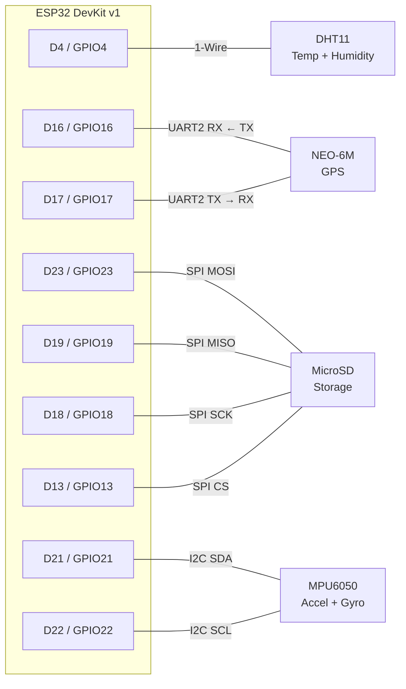

# Pin Configuration

Target board: **ESP32 DevKit v1** (30-pin or 36-pin). The `Dn` labels below are
the silkscreen markings; the GPIO numbers are what the firmware uses.

All pin definitions live in one place —
[`src/config.h`](../src/config.h) — and nothing else in the firmware hardcodes a
pin number.

## Complete pin table

| Module | Module pin | ESP32 pin | GPIO | Bus / role | Notes |
|---|---|---|---|---|---|
| **DHT11** | OUT | D4 | 4 | 1-Wire data | `PIN_DHT_DATA` |
| | + | 3V3 | — | Power | 3.3 V |
| | − | GND | — | Ground | |
| **MPU6050** | SDA | D21 | 21 | I²C data | `PIN_I2C_SDA` |
| | SCL | D22 | 22 | I²C clock | `PIN_I2C_SCL` |
| | VCC | 3V3 | — | Power | 3.3 V |
| | GND | GND | — | Ground | |
| **NEO-6M GPS** | TX | D16 | 16 | UART2 RX ← | `PIN_GPS_RX` |
| | RX | D17 | 17 | UART2 TX → | `PIN_GPS_TX` |
| | VCC | 3V3 | — | Power | see warning below |
| | GND | GND | — | Ground | |
| **MicroSD** | MOSI | D23 | 23 | SPI MOSI | `PIN_SD_MOSI` |
| | MISO | D19 | 19 | SPI MISO | `PIN_SD_MISO` |
| | SCK | D18 | 18 | SPI clock | `PIN_SD_SCK` |
| | CS | D13 | 13 | SPI chip select | `PIN_SD_CS` |
| | VCC | 3V3 | — | Power | 3.3 V |
| | GND | GND | — | Ground | |

> **LEDs and buzzers are not part of this revision.** No indicator GPIO is
> allocated or driven.

## Wiring diagram



## Three things that commonly go wrong

### 1. GPS TX/RX must cross over

This is the single most common wiring mistake, and it fails silently — the module
powers up, its fix LED may even blink, and yet not one byte reaches the ESP32.

`PIN_GPS_RX` is the pin on which the **ESP32 receives**, so it connects to the
GPS module's **TX**:

```
NEO-6M TX  ──────────►  D16  (ESP32 RX2, PIN_GPS_RX)
NEO-6M RX  ◄──────────  D17  (ESP32 TX2, PIN_GPS_TX)
```

If `charsProcessed()` stays at zero, swap these two wires first.

### 2. Check your NEO-6M breakout's voltage

Many NEO-6M breakouts accept 5 V on VCC (they carry an onboard regulator) while
others are bare 3.3 V modules. Feeding 5 V to a bare module will damage it.
**Check your specific board before powering it.** Their logic output is 3.3 V
either way, which is safe for the ESP32.

### 3. GPIO pins you should not move these to

If you re-map anything, avoid:

| GPIO | Why to avoid |
|---|---|
| 6–11 | Wired to the on-board SPI flash — using them will not boot |
| 0, 2, 12, 15 | Strapping pins; affect boot mode |
| 34–39 | **Input only** — no output, no internal pull-ups |

GPIO 13 was chosen for SD chip select specifically because it is free of all of
these constraints on a DevKit v1.

## Bus notes

**I²C (MPU6050)** — default address `0x68`. Pulling the module's `AD0` pin high
changes it to `0x69`; set `MPU6050_I2C_ADDR` in `config.h` to match. Most
breakouts include the required pull-up resistors on SDA/SCL; a bare chip needs
4.7 kΩ pull-ups to 3.3 V added externally.

**UART2 (GPS)** — 9600 baud, 8N1. This is the NEO-6M factory default.

**SPI (MicroSD)** — VSPI at 4 MHz. The frequency is deliberately conservative:
jumper wires on a breadboard have enough stray capacitance that the 40 MHz the
ESP32 is capable of will produce intermittent read errors. Raise
`SD_SPI_FREQ_HZ` only once the wiring is soldered.

The card must be formatted **FAT32**. exFAT is not supported by the ESP32 SD
library, and a card larger than 32 GB will often arrive exFAT-formatted.

## Shared-bus caution

The SD card has the VSPI bus to itself in this design. If you later add another
SPI peripheral, each device needs its **own** chip-select pin — sharing one CS
line will corrupt both devices' traffic.
